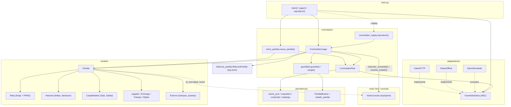

# Análisis de arquitectura — Vista Pygame

FASE 1 de la migración a Pygame (rama `feature/vista-pygame`). Cubre cómo se conectan
Modelo, Vista, Controlador y Adaptadores hoy, qué acoplamientos impiden enchufar otra
vista, y el plan de migración. No incluye código de la escena de partida (eso es FASE 2).

## 1. Cómo se conectan Modelo, Vista, Controlador y Adaptadores



Puntos clave:

- **`main.py`** decide la fuente (`--offline` o HTTP), arma la `SesionPartida`
  (`inicio_partida.nueva_partida`) y crea un `ControladorJuego(sesion, vista, ruta_guardado)`.
  `vista` es cualquier objeto que cumpla el protocolo duck-typed de `VistaConsola`
  (no hay una clase base formal hoy).
- **`ControladorJuego`** es el único punto que toca el modelo desde fuera: valida
  comandos, llama a `Partida`/`Jugador`/`Historial`/`Reloj`, y reenvía lo que pasa a
  la vista. El modelo nunca conoce a la vista ni al controlador directamente, salvo
  por los `Vector` de callbacks que `Partida` expone (`al_mensaje`, `al_entrar_sala`,
  `al_morir_enemigo`).
- **`ControladorRed`** es independiente de la vista y del controlador de juego; solo
  habla con `FuenteDeDatos` y la caché en disco (`persistencia/`).
- **`replay`** y **`bench`** reutilizan `ControladorJuego` con una vista no interactiva
  (`GuionReplay`) o no lo usan en absoluto; ninguno de los dos importa pygame hoy, y
  así debe seguir (regla 5).

## 2. Qué lee hoy la vista de consola del estado

Todo a través de `partida` (objeto completo, sin copia ni capa intermedia):

| Dato mostrado | De dónde sale |
| --- | --- |
| Sala, salidas, puertas (abierta/cerrada/llave/cierre) | `partida.jugador.sala_actual`, `sala.salidas` (cada `Salida` con `direccion`, `cerrada`, `llave`, `evento_cierre`) |
| Enemigos de la sala, vida, comportamiento | `sala.enemigos_activos` (`ListaSimple` de `Enemigo`) |
| Objetos en el suelo | `sala.objetos_suelo` |
| Trampas (armada / desarmada) | `sala.trampas` |
| Vida, ataque, defensa, velocidad, equipo | `partida.jugador` (atributos directos de `Actor`) |
| Efectos activos (veneno, velocidad, antorcha) | `jugador.estado_veneno`, `jugador.evento_mod_velocidad`, objetos `antorcha` del inventario con `.encendida` |
| Inventario | `jugador.inventario` (`ListaDoble`), `jugador.inventario_ordenado(criterio)` |
| Tiempo virtual | `partida.tiempo` (propiedad de `partida.reloj.tiempo_actual`) |
| Últimos 20 mensajes | los acumula la propia vista en un `ArrayCircular`, alimentado por el callback `al_mensaje` |

La vista **nunca llama a `partida.reloj.avanzar_*`** ni a nada que mueva el tiempo:
solo lee. El reloj virtual avanza exclusivamente dentro del ciclo de `ControladorJuego`.

## 3. Qué acciones envía el controlador

`ControladorJuego._turno_jugador()` interpreta el texto de `vista.leer_comando()` con
`interpretar()` y, tras validar (`_validar`), llama a una de estas rutas en `_aplicar`:

| Comando | Llamada al modelo | Costo |
| --- | --- | --- |
| Mover | `red.asegurar_entrada(...)` (validación, puede esperar red) → `partida.entrar_a_sala(destino)` | 100 |
| Atacar | `partida.atacar(enemigo)` | 100 |
| Esperar | (nada, solo mensaje) | 100 |
| Recoger | `jugador.recoger(objeto)` | 25 |
| Soltar | `jugador.soltar_nodo(nodo)` | 25 |
| Equipar | `jugador.equipar_nodo(nodo)` | 50 |
| Usar | `partida.usar_objeto(nodo)` | 50 |
| Abrir | `partida.abrir(salida)` | 50 |
| Pergamino | `historial.usar_pergamino(...)` | sin tiempo, fuera de `_aplicar` |
| Inventario / ayuda / guardar / cargar / cursor | no tocan el reloj | sin tiempo |

Cada comando con costo pasa por `historial.iniciar_accion()` → `_aplicar()` →
`partida.contar_accion_jugador()` → se registra en la bitácora y en `sesion.acciones`.

## 4. Cómo se entera la vista de lo ocurrido entre dos acciones

No hay un bus de eventos tipado: es una **bitácora en pantalla**. `Partida` llama a
`self._emitir(texto)` en cada hecho narrable (entrar a sala, trampa, ataque, muerte,
abrir puerta, subir objeto...), que recorre `partida.al_mensaje` (un `Vector` de
funciones `f(tiempo, texto)`). `ControladorJuego.__init__` registra
`vista.agregar_mensaje` ahí. Los eventos del entorno que no son turno de un actor
(veneno, regeneración, rearme de trampa, cierre de puerta...) se narran aparte, en
`ControladorJuego.ciclo()`, vía `narrador_eventos.describir_evento(partida, evento,
vida_antes)` — compara la vida antes/después y decide si el jugador lo percibe (si
está en su sala) y qué texto mostrar.

Para una vista no textual (Pygame) esto es un problema: **no hay eventos tipados**,
solo strings ya formateados en español para humanos. La cola de animaciones de mi
compañero (`ColaAnimaciones.agregar_desde_eventos`) necesita algo más estructurado
que un string. Ver la sección 6 y el contrato correspondiente en `CONTRATOS.md`.

## 5. Victoria/derrota, puntaje, solicitudes, presupuesto y caché

- **Victoria/derrota**: `Partida.verificar_fin()` (se llama tras cada acción relevante:
  `entrar_a_sala`, `ejecutar_accion_enemigo`, y dentro de `atacar`/daño vía
  `recibir_dano`→`morir`). Derrota si `not jugador.vivo`; victoria si
  `jugador.sala_actual.id == cripta.sala_salida_id`. Pone `partida.estado` en
  `"victoria"` o `"derrota"` y emite el mensaje narrativo. **La vista no decide nada
  de esto**, solo lee `partida.estado` al final (`mostrar_fin`).
- **Resumen de la partida**: `Partida.resumen_puntaje()` devuelve
  `cripta_id, version_cripta, acciones_jugador, enemigos_derrotados, tiempo_final,
  resultado` — todo ya acumulado por el modelo durante la partida, sin recálculo.
- **Solicitudes realizadas y presupuesto**: `fuente.requests_realizados` (contador del
  adaptador HTTP; offline no cuenta) y `partida.cripta.presupuesto_solicitudes`
  (viene de los datos generales de la cripta). Los junta `reporte_red.construir_reporte`.
- **Aciertos/fallos de caché**: `ControladorRed.estadisticas_cache()` →
  `lru.contador_aciertos` / `lru.contador_fallos` de la `ListaLRU` de fichas
  (`red._fichas`).
- **⚠️ Tabla de puntajes persistente: no existe todavía.** El propio README lo dice
  explícitamente en "Estado del proyecto": *"Completar la tabla persistente de
  puntajes. Actualmente se muestra el resumen de la partida, pero no hay una tabla de
  clasificación guardada."* Confirmé con `grep` que ningún módulo registra un
  historial de partidas jugadas. Lo que sí existe y persiste en disco es
  `reporte_red.HistorialReportesRed` (`partidas/reportes_red.txt`), pero es un
  historial de **solicitudes de red**, no un ranking de jugadores/partidas. Esto choca
  con el encargo ("verifica que el registro en la tabla de puntajes local ocurra
  igual que en consola, lo hace el modelo, no la vista"): la consola tampoco lo hace
  hoy. Lo marco como **pregunta abierta en la sección 8**, no lo invento por mi cuenta.

## 6. Acoplamientos que impiden conectar otra vista

Este es el hallazgo central de la FASE 1, porque condiciona todo el diseño de
`app.py` y `controlador_pygame.py`:

1. **`ControladorJuego._turno_jugador()` es un bucle bloqueante.** Llama
   `vista.leer_comando()` (que en consola es `input()`) y no vuelve a su llamador
   hasta que el jugador complete una acción con costo. Mientras tanto puede volver a
   llamar `vista.mostrar_estado()` varias veces (tras cada rechazo) sin que el
   controlador externo tenga control. **Un bucle de Pygame no puede llamar a esto
   directamente**: si lo hace en el hilo principal, la ventana se congela (no se
   procesan eventos de SO, no hay 60 FPS) hasta que alguien "escriba" un comando.
2. **`vista.leer_comando()` también se usa para esperar la respuesta de red.**
   `_validar()` → `red.asegurar_entrada(sala_destino_id)` puede bloquear hasta 120 s
   reales (`ControladorRed.ESPERA_MAXIMA_SEGUNDOS`) dentro de la misma llamada que
   procesó el comando "mover". Esto ya ocurre *después* de que `leer_comando()`
   devolvió el texto, dentro de `_turno_jugador`, no en la vista — pero el efecto es
   el mismo: quien haya llamado a `ControladorJuego.jugar()` queda bloqueado todo ese
   tiempo.
3. **`ControladorJuego.jugar()` controla su propio bucle principal** (`while not
   partida.terminada and not self._salir: self.ciclo()`), no cede el control acción
   por acción. No hay un método "procesa un solo paso y devuélveme el control" listo
   para usar: `ciclo()` sí procesa un solo paso del reloj, pero `_turno_jugador()`
   (llamado dentro de `ciclo()` cuando le toca al jugador) internamente vuelve a
   bloquear en otro `leer_comando()` si el comando no costó tiempo (ayuda, inventario,
   guardar, pergamino...). Es decir, ni siquiera `ciclo()` por sí solo da "una
   llamada = una acción de red"; puede consumir varios comandos sin costo antes de
   devolver el control.
4. **Mensajes como texto ya traducido**, no eventos tipados (sección 4).
5. **La persistencia (`G`/`L`) y la salida (`Q`) viven dentro del mismo bucle de
   comandos**, mezcladas con las acciones de juego — no hay una API separada
   "guardar ahora" invocable desde fuera sin pasar por `leer_comando()`.

Nada de esto exige tocar el modelo: el acoplamiento está en `ControladorJuego`
(un bucle síncrono pensado para `input()`), no en `Partida`. **No propongo modificar
`controlador_juego.py`**: la vista de consola debe seguir funcionando exactamente
igual, y tocar ese archivo arriesga justamente eso. En su lugar, lo envuelvo.

## 7. Plan de migración

### Decisión de diseño: `ControladorJuego` corre en un hilo de fondo, detrás de una vista-adaptador

`controlador_pygame.py` implementa una clase que **cumple el protocolo de
`VistaConsola`** (duck typing: `agregar_mensaje`, `mensajes`, `restaurar_mensajes`,
`mostrar_estado`, `mostrar_inventario`, `mostrar_ayuda`, `mostrar_objeto`,
`mostrar_fin`, `leer_comando`) pero en vez de usar `input()`/`print()`:

- `leer_comando()` bloquea sobre una `queue.Queue` propia del hilo de modelo
  (`queue.get()`), que la escena de partida llena con `queue.put(texto_comando)`
  cuando el jugador pulsa una tecla mapeada a una acción. Esto preserva **"una
  acción del jugador = una llamada al controlador"**.
- `mostrar_estado(partida)` no imprime nada: construye una foto de solo lectura del
  estado relevante (o guarda la referencia a `partida`, protegida por un lock, dado
  que entre llamadas el hilo de modelo no la muta salvo dentro de sus propios
  métodos) y la publica en un buzón que la escena de Pygame lee en su `actualizar()`,
  sin bloquear el hilo de render.
- `agregar_mensaje(tiempo, texto)` empuja a una cola de "eventos ocurridos" que
  alimenta tanto el panel de mensajes del HUD como `ColaAnimaciones.
  agregar_desde_eventos(eventos)` y `GestorAudio.reproducir_sfx(...)`.
- `mostrar_fin(partida)` es el punto donde, igual que en consola, la partida ya
  terminó (`partida.terminada`); ahí se arma el `ResumenPartida` leyendo
  directamente del modelo y de `sesion.red`/`fuente` (igual que
  `reporte_red.construir_reporte`), sin recalcular nada, y se publica para que la
  escena cambie a `FIN_PARTIDA`.
- El hilo de modelo se lanza con `threading.Thread(target=controlador.jugar,
  daemon=True)` dentro de `ControladorPygame.iniciar_partida(...)`. `ciclo()` del
  modelo sigue corriendo a su propio ritmo; el requisito de **<20 ms por ciclo
  (§5.2)** se cumple de forma natural porque ese hilo nunca espera al render ni a
  vsync — solo espera cuando el jugador no ha decidido (bloqueado en `queue.get()`,
  que no cuenta como "ciclo") o cuando hay que esperar contenido de red (tiempo real,
  no virtual, y tampoco congela Pygame porque está en otro hilo).
- `guardar()`, `cargar()`, `salir()` desde las escenas de menú/pausa no tocan el
  modelo directamente: encolan un comando equivalente a `G`/`L`/`Q` hacia el mismo
  hilo, igual que ya hace la consola. Esto evita cualquier carrera de datos con el
  hilo de modelo.

Esta envoltura no requiere ni una línea de cambio en `modelo/`, `adaptadores/`,
`estructuras/`, ni en `controlador/controlador_juego.py`: la consola sigue
funcionando exactamente igual, con su propia `VistaConsola` síncrona.

### Opción A (hilo de fondo) frente a Opción B (extraer un paso no bloqueante)

Pediste estimar el tamaño de una alternativa antes de comprometernos: en vez de
envolver `ControladorJuego` en un hilo, extraer de `_turno_jugador()` un método tipo
`procesar_comando(texto) -> costo | None` que la escena de Pygame pueda llamar una
vez por tecla, sin hilos, manteniendo la consola idéntica.

**Lo que exigiría la Opción B**, mirando el código real de `_turno_jugador()`
(`controlador/controlador_juego.py:215-265`):

- Hoy la función mezcla dos granularidades en un mismo `while True`: (1) un
  *housekeeping* que corre **una sola vez por turno** (`confirmar_accion()`,
  `red.incorporar_listas()`, fuera del `while`) y (2) un refresco que corre **en cada
  intento** (`_sincronizar_protegidas()`, `mostrar_estado()`, dentro del `while`,
  incluso tras un comando gratuito o un rechazo). Separar esto en un método
  reentrante exige que `ControladorJuego` guarde en `self` un estado explícito
  ("¿ya hice el housekeeping de este turno o no?") que hoy vive implícito en la pila
  de llamadas de Python. Es un cambio de forma, no solo de ubicación del código.
- `jugar()`/`ciclo()` tendrían que dejar de ser dueños de su propio bucle y volverse
  una máquina de estados reanudable (`ESPERANDO_JUGADOR` / `PROCESANDO`) que Pygame
  pueda "tickear" desde su propio bucle de eventos.
- **No elimina el hilo, solo lo reduce de alcance.** `_validar()` para "mover" llama
  `red.asegurar_entrada(...)`, que puede bloquear hasta 120 s reales
  (`ControladorRed.ESPERA_MAXIMA_SEGUNDOS`) esperando el contenido de una sala nueva.
  Esa espera sigue estando dentro de la misma llamada síncrona que procesa el
  comando "mover". Para que Pygame no se congele igual durante una carga lenta
  (requisito explícito del encargo), esa espera concreta necesita volverse no
  bloqueante de todos modos — con un hilo o future *propio*, ya sea dentro de
  `ControladorRed` o en una envoltura alrededor de `_validar`. Es decir: la Opción B
  no evita el hilo, lo reduce a un caso (la espera de red) pero lo sigue necesitando.
- `GuionReplay` (usado por `--replay`) también llama `leer_comando()` con semántica
  de "una llamada = un comando", apoyada en `_verificar_anterior()` que cuenta
  llamadas. Cualquier cambio de forma en `_turno_jugador()` tiene que preservar ese
  contrato exacto para no romper el replay ni la herramienta de determinismo
  (`herramientas.verificar_determinismo`).
- Validación: no basta con pasar unas pocas pruebas nuevas. Como se toca el archivo
  que ejercitan los 665 tests actuales (comandos, pergamino, guardar/cargar, replay,
  determinismo), la única forma responsable de confirmar "consola idéntica" es correr
  toda la suite y la herramienta de determinismo tras el cambio, y revisar a mano los
  casos de rechazo intercalados con comandos gratuitos (ayuda, inventario, guardar)
  que son justo la parte más fácil de desordenar al partir la función.

**Estimación comparativa:**

| | Opción A (hilo de fondo) | Opción B (paso no bloqueante) |
| --- | --- | --- |
| Líneas tocadas en `controlador_juego.py` | 0 | ~150-250 (reescritura de `_turno_jugador`, `ciclo`, `jugar`) |
| Archivos nuevos | `controlador_pygame.py` (~150-250 líneas: hilo, cola, buzón de estado) | mismo archivo nuevo, pero más simple (sin hilo propio para el turno; aun así necesita uno acotado para la espera de red) |
| Riesgo de romper la consola | Ninguno (cero líneas compartidas tocadas) | Real: mismo archivo que corre en cada partida de consola, replay y determinismo |
| Resuelve "Pygame no se congela durante la carga de una sala" | Sí, gratis, por diseño | Solo si además se asila la espera de red (trabajo adicional, no incluido en la tabla de líneas) |
| Validación necesaria | Tests nuevos de `vista_pygame/` | Tests nuevos **+** correr los 665 tests existentes **+** `herramientas.verificar_determinismo` **+** revisión manual de los casos de rechazo/comando gratuito |
| Tamaño total estimado | Medio — un día de trabajo enfocado, la mayor parte en acertar el patrón de copia segura entre hilos una vez | Grande — varios días, con el archivo más sensible del proyecto como superficie de cambio, y sin eliminar realmente la necesidad de un hilo |

**Recomendación:** mantener la Opción A. No es solo más chica; la Opción B no
cumple sola el requisito de no congelar Pygame durante una carga de sala, así que
terminaría necesitando un hilo de todos modos además de la reescritura. Quedo a la
espera de tu confirmación para seguir con la Opción A en la FASE 2.

### Riesgo a vigilar

Compartir `partida` entre el hilo de modelo (que la muta) y el hilo de Pygame (que
la lee para dibujar) exige disciplina: la escena de partida debe leer los campos que
necesita y soltarlos cada frame, nunca guardar referencias vivas a listas internas
(`ListaSimple`, `ListaDoble`) entre frames, porque pueden cambiar de nodo a mitad de
lectura. Propongo que `mostrar_estado` construya una copia liviana (tuplas/listas
planas de los campos que la vista necesita) en el hilo de modelo, con un lock corto,
y que la escena solo lea esa copia. Lo detallo en `CONTRATOS.md`.

### Archivos a crear (FASE 2)

```
vista_pygame/
  __init__.py
  app.py                    # bucle principal, reloj FPS, cambio de escenas
  config_vista.py           # resolución, escalado, FPS, ids de escena, paleta
  contratos.py               # ya creado en esta fase
  stubs_temporales.py        # placeholders de lo que hace mi compañero
  controlador_pygame.py      # hilo de ControladorJuego + cola de comandos + buzón de estado
  entrada/
    mapeo_teclas.py
  escenas/
    escena_base.py
    partida.py
  render/
    render_sala.py
    render_actores.py
tests/vista/
  test_mapeo_teclas.py
  test_controlador_pygame.py
  test_paridad_consola_gui.py
  test_sin_pygame_en_replay_bench.py
  test_contratos.py
  test_fin_partida.py
  test_rendimiento_vista.py
  test_render_enemigos.py    # sala con 0, 1, muchos enemigos y tipo desconocido;
                             # dormidos + activos juntos; enemigo muerto no se dibuja;
                             # tiempo de dibujado con muchos enemigos
```

`main.py` gana `--gui` (importa pygame y `vista_pygame.app` solo si se pasa esa
bandera), sin tocar las rutas de `--offline`, `--replay` ni `--bench`.

## 8. Decisiones y propuestas pendientes de aprobación

### 8.1 Tabla de puntajes persistente — queda fuera de esta migración (decidido)

Confirmado: `tabla_puntajes()` en `ControladorPygame` (y el equivalente que use la
consola) **devuelve una lista vacía por ahora**. La tabla real se implementa después,
como tarea aparte, con registro en el modelo, persistencia en un adaptador propio de
disco y ordenamiento con el selector Insertion/Merge del proyecto, compartida por
consola y GUI. Diseño propuesto para esa tarea futura (nada de esto se implementa en
esta migración):

- **`modelo/puntaje.py`** (nuevo): entidad `EntradaPuntaje` — datos planos (sin
  dict-como-índice): `nombre_jugador`, `cripta_id`, `version_cripta`, `resultado`,
  `acciones_jugador`, `enemigos_derrotados`, `tiempo_final`, `fecha`. Una función
  `crear_entrada(partida, nombre_jugador, fecha=None)` que arma la entrada a partir
  de `partida.resumen_puntaje()` (sin recalcular nada), igual que ya hace
  `ResumenPartida`.
- **`persistencia/tabla_puntajes.py`** (nuevo, adaptador de disco): mismo patrón que
  `reporte_red.HistorialReportesRed` (que ya reescribe un archivo de texto con una
  `Pila` propia): lee/escribe entradas en `partidas/tabla_puntajes.txt` o `.json`
  (a decidir), usando `Vector`/`Pila` del proyecto, nunca un dict como índice.
- **`controlador/puntajes.py`** (nuevo, capa compartida): `registrar_puntaje(sesion,
  nombre_jugador)` — construye la entrada (`modelo.puntaje.crear_entrada`) y la pasa
  al adaptador de persistencia. `listar_puntajes()` — lee todas las entradas y las
  ordena con `estructuras.ordenamientos.ordenar(vector, comparador)` (el mismo
  selector Insertion/Merge que ya usa el inventario y los benchmarks), devuelve un
  `Vector` ya ordenado. El criterio de orden (¿victorias primero? ¿menor tiempo?
  ¿más enemigos derrotados?) y si una salida manual (`Q`) cuenta, quedan para esa
  tarea — no los decido aquí.
- **`main.py`**: tras `controlador.jugar()` (consola), llamar
  `controlador.puntajes.registrar_puntaje(sesion, nombre_jugador)` — mismo punto
  donde hoy se llama `_mostrar_reporte`.
- **`vista_pygame/controlador_pygame.py`**: `mostrar_fin(partida)` (el mismo punto
  donde arma `ResumenPartida`) llama al mismo `registrar_puntaje`, y
  `tabla_puntajes()` deja de devolver `[]` y delega en `listar_puntajes()`.
- **`vista/vista_consola.py`**: eventualmente un comando para listar la tabla (p. ej.
  `TP`), simétrico al botón/panel que tendría la GUI — opcional, a decidir con esa
  tarea.
- **Pruebas**: `tests/test_puntaje.py` (entidad + `crear_entrada`),
  `tests/test_tabla_puntajes.py` (adaptador de disco),
  `tests/test_controlador_puntajes.py` (registrar/listar, orden).
- **`docs/decisiones/`**: una decisión nueva documentando el criterio de orden y qué
  partidas cuentan, igual que ya existen decisiones para caché, inventario y
  ordenamiento.

### 8.2 `nombre_jugador` — propuesta de cambio mínimo, pendiente de tu aprobación

Corrijo mi plan anterior: no es cosmético (lo exige §2.12 para la tabla de
puntajes), así que no puede vivir solo en `ControladorPygame` ni en la entidad
`Jugador`. Propongo que viva en el **controlador compartido** — el mismo que usan
consola y GUI — y se pida en ambos lados antes de crear la partida:

1. **`controlador/inicio_partida.py`**: `nueva_partida(fuente, cripta_id,
   carpeta_cache=None, semilla=None, ruta_bitacora=None, cache_size=25,
   despachador=None, nombre_jugador=None)` — nuevo parámetro opcional (valor por
   defecto `"Jugador"` si viene `None` o vacío, para no romper nada que llame a
   `nueva_partida` sin indicarlo, como el replay). Se guarda como
   `SesionPartida.nombre_jugador`, junto a `partida`, `red`, `fuente`, `bitacora`.
   No toca `Jugador` ni ningún archivo de `modelo/`.
2. **`vista/vista_consola.py`**: un método nuevo, p. ej.
   `pedir_nombre_jugador(defecto="Jugador")`, que hace un `input()` simple antes de
   iniciar. Mismo patrón que `elegir_cripta`.
3. **`main.py`** (función `jugar()`): llama a `vista.pedir_nombre_jugador()` antes de
   `nueva_partida(...)` y le pasa el resultado.
4. **`vista_pygame/controlador_pygame.py`** (FASE 2): `iniciar_partida(id_cripta,
   nombre_jugador, semilla)` ya recibe `nombre_jugador` (lo definimos así en
   `CONTRATOS.md` §2); el único ajuste es que ahora lo reenvía a
   `nueva_partida(..., nombre_jugador=nombre_jugador)` en vez de guardarlo solo en
   `ControladorPygame`. La escena de menú de mi compañero sigue siendo quien lo pide
   (pantalla de texto antes de elegir cripta, o junto a ella).
5. **`controlador/guardado.py`**: en `guardar()`, agregar
   `globales['nombre_jugador'] = sesion.nombre_jugador` junto al resto de
   `globales` (que ya incluye `partida.encabezado()`). En `cargar()`, leer
   `datos.get('nombre_jugador')` y pasarlo al construir la `SesionPartida` nueva. Así
   el nombre sobrevive a guardar/cargar, como pediste.
6. **Cuando exista la tabla de puntajes (8.1)**: `registrar_puntaje(sesion,
   nombre_jugador)` recibe `sesion.nombre_jugador` como argumento explícito — el
   nombre nunca se guarda en `Partida` ni en `Jugador`, solo se pasa en el momento de
   registrar.

No toco `bitacora_partida.py` en esta propuesta (el `.log` de replay no lleva hoy el
nombre del jugador, y el encargo solo pide guardado y registro de puntaje); si el
equipo quiere que el replay también recupere el nombre para poder re-registrar un
puntaje desde una bitácora vieja, lo trato como pregunta aparte cuando llegue la
tarea de la tabla.

**Archivos que tocaría este cambio** (ninguno modificado todavía — espero tu
aprobación): `controlador/inicio_partida.py`, `vista/vista_consola.py`, `main.py`,
`controlador/guardado.py`, y en FASE 2 `vista_pygame/controlador_pygame.py` +
`CONTRATOS.md` (ajustar la nota de origen de `nombre_jugador`).

### 8.3 Confirmado: `--gui` reemplaza la consola

`main.py --gui` reemplaza la vista de consola (no coexisten en la misma ejecución);
`--offline`/`--cripta`/`--cache-*` siguen aplicando igual con `--gui`.

### 8.4 Propuesta: dos hooks nuevos en `Partida` para animar enemigos (pendiente de aprobación)

Para la escena de partida (sección 9), el requisito de pasar "TODOS los eventos, en
el orden del modelo" a `ColaAnimaciones` choca con el mismo límite de la sección 4:
hoy el único canal estructurado que ya existe para enemigos es
`Partida.al_morir_enemigo` (`f(enemigo)` — ya sirve tal cual, sin cambios). Pero el
**movimiento** de un enemigo entre salas y los **ataques** (en cualquier dirección)
solo llegan a la vista como texto ya traducido (`"Rata gigante #1 entra en la
sala."`, `"... te ataca: -3 de vida."`), insuficiente para decidir qué sprite animar,
hacia qué puerta, o cuánto daño mostrar en un número flotante.

Propongo agregar, siguiendo exactamente el patrón ya usado por `al_morir_enemigo` /
`al_entrar_sala` / `al_mensaje` (un `Vector` vacío por defecto, sin efecto para la
consola si nadie se suscribe):

```python
# modelo/partida.py, en Partida.__init__, junto a los Vector existentes:
self.al_mover_enemigo = Vector()   # f(enemigo, sala_origen, sala_destino)
self.al_atacar = Vector()          # f(atacante, objetivo, dano)
```

- `al_mover_enemigo` se dispara en `_mover_enemigo`, junto al `_emitir` que ya hay
  ahí (no lo reemplaza). La dirección visual (por qué puerta entra/sale) la calcula
  la vista por su cuenta recorriendo `sala.salidas` — no hace falta que el modelo la
  calcule.
- `al_atacar` se dispara en dos puntos que ya calculan exactamente esos tres datos:
  `Partida.atacar()` (jugador ataca) y la rama `"atacar"` de
  `ejecutar_accion_enemigo()` (enemigo ataca). Un solo hook cubre ambas direcciones;
  la vista decide cómo animar cada una según si `atacante is partida.jugador`.

Es un cambio aditivo de ~6 líneas en `modelo/partida.py`, cero riesgo para la consola
(nadie se suscribe hoy), pero **es el modelo**, así que lo propongo en vez de
implementarlo, como pide la regla 2. Si prefieres que lo resuelva de otra forma (por
ejemplo, sin tocar `Partida` y aceptando que el movimiento/ataque de enemigos se
anime de forma más genérica a partir de los mensajes de texto, sin saber exactamente
qué sprite corresponde), dímelo y ajusto el diseño de la sección 9.

### 8.5 Propuesta: lectura de solo lectura de los próximos turnos (pendiente de aprobación)

Para el panel opcional "Próximos turnos" (sección 9), no existe hoy forma de leer
los próximos N eventos de la agenda sin extraerlos (`HeapMinimo` solo expone
`minimo()`, que da la raíz, no los primeros N). Propongo, también de forma aditiva y
sin tocar el comportamiento existente:

```python
# estructuras/heap_minimo.py
def vista_ordenada(self, n):
    """Copia de solo lectura: hasta las primeras n entradas válidas, ordenadas por
    (tiempo, secuencia). No extrae, no muta el heap ni sus contadores."""
```

Internamente copia las entradas válidas de `self._datos` a un `Vector` propio y las
ordena con `estructuras.ordenamientos.ordenar` (mismo selector Insertion/Merge, nada
de `sorted()`), sin tocar `_datos` original ni ningún contador.

```python
# modelo/reloj.py
def proximos_eventos(self, n):
    """Envoltura delgada sobre agenda.vista_ordenada(n), para no exponer el heap
    interno fuera de Reloj."""
```

También aditivo (~15-20 líneas entre los dos archivos), cero riesgo para la consola
y para el resto del modelo (nadie más la llama). Como toca `estructuras/` y
`modelo/`, la propongo en vez de implementarla. Si apruebas, la escena de partida
leería `partida.reloj.proximos_eventos(5)` una vez por actualización de estado (no
en cada frame) y traduciría cada entrada a una etiqueta (`"Jugador"`,
`partida.nombre_enemigo(enemigo)`, o una descripción genérica del efecto) con datos
que ya tiene disponibles.

### Estado: 8.2, 8.4 y 8.5 aprobados e implementados

Con las condiciones que pusiste:

- **8.2**: `nombre_jugador` vive en `SesionPartida` (`controlador/inicio_partida.py`),
  se pide en consola (`VistaConsola.pedir_nombre_jugador`) y viaja al guardado.
  `controlador/guardado.py` subió `esquema_estado` de 1 a 2 e incluye
  `nombre_jugador`; cargar un guardado con esquema 1 da
  `ValueError` con un mensaje explícito de incompatibilidad. Test:
  `tests/test_consola_persistencia_replay.py::
  test_nombre_jugador_persiste_y_guardado_antiguo_es_incompatible`.
- **8.4**: `Partida.al_mover_enemigo` / `Partida.al_atacar` agregados en
  `modelo/partida.py`, vacíos por defecto, solo agregan a quien se suscriba (en
  el hilo del modelo), nunca llaman a `reloj.azar`. Test:
  `tests/test_partida.py::test_hooks_vista_no_alteran_determinismo` (misma
  semilla, con y sin hooks, mismo resultado exacto).
- **8.5**: `HeapMinimo.vista_ordenada(n)` (heap auxiliar de índices, no copia ni
  reordena `_datos`, no toca contadores) + `Reloj.proximos_eventos(n)` (filtra
  actores muertos). Tests en `tests/test_rol3_bloque3.py`:
  `test_vista_ordenada_es_de_solo_lectura_y_filtra_cancelados` (secuencia de
  extracciones idéntica con y sin llamadas de más a `vista_ordenada`),
  `test_vista_ordenada_no_copia_el_heap_entero` (cuenta accesos a `_datos`),
  `test_reloj_proximos_eventos_omite_actor_muerto`. Medido en `--bench`
  (`bench/casos/heap.py`, caso `proximos_turnos`): `vista_ordenada(5)` se
  mantiene ~6 ms para 200 llamadas sin importar el tamaño del heap (100 a 5000
  eventos), mientras que la alternativa de copiar-y-ordenar todo crece de
  ~11 ms a ~1037 ms en el mismo rango — confirma que no recorre el heap entero.

La suite completa (670 tests: 665 + 5 nuevos) y `python main.py --bench` corren
en verde con estos cambios.

### Bloque de requisitos adicionales — confirmado en el plan

| Requisito | Cómo queda cubierto |
| --- | --- |
| Log GUI → replay | La escena de partida escribe la bitácora exactamente igual que la consola (mismo `ControladorJuego`, sin tocarlo). Agrego una verificación explícita a `tests/vista/test_paridad_consola_gui.py` (FASE 3): jugar una secuencia fija vía `ControladorPygame`, cerrar la sesión, y reproducir el `.log` resultante con `controlador.controlador_replay.reproducir()` — debe reproducirse sin errores y coincidir con el estado final. |
| Retroceso en la vista | El pergamino pasa por la cola de comandos como cualquier otra acción (condición de la Opción A). No hace falta un caso especial: `mostrar_estado` siempre publica el estado ya revertido, y el mensaje "Lees el pergamino: el tiempo retrocede..." llega al HUD como cualquier otro mensaje. Lo cubre `test_controlador_pygame.py` con un escenario P tras una acción. |
| Errores 429 / fallas de red | Ya fluyen por el camino existente: `ControladorRed.garantizar_contenido` reintenta dentro del presupuesto y, si falla, `asegurar_entrada` devuelve un texto de rechazo que se muestra como mensaje (igual que en consola). Lo distinto de la condición "ninguna excepción muere en silencio" (sección 7) es para errores *no* capturados por ese camino (un bug real); para eso, `ControladorPygame` atrapa cualquier excepción no manejada del hilo de fondo y la expone a la escena. Test con una fuente simulada que lanza 429 repetidos. |
| Cargar partida desde la GUI | `ControladorPygame.cargar(ruta)` encola el comando (condición 5), igual que `L` en consola; lo usa la escena de pausa/menú. |
| Minimapa | Nuevo elemento del HUD en `escenas/partida.py` / `render/render_sala.py`: un layout calculado una vez por cripta (BFS desde `sala_inicial`, offsets N/S/E/O de una unidad por dirección — el modelo no tiene coordenadas, así que el layout es puramente de presentación), mostrando como visitadas las salas con `tiempo_rastro >= 0` y resaltando la sala actual. Es de solo lectura, no pide nada nuevo al modelo. |
| Tecla F1 | Se mapea en `entrada/mapeo_teclas.py` a un overlay de ayuda que reutiliza el texto de `vista.vista_consola.AYUDA` (import de solo lectura, sin duplicar el texto ni modificar ese archivo). |

Nada de esto faltaba conceptualmente, pero no estaba explícito en el plan de FASE 2
hasta ahora; ya quedó incorporado antes de escribir las escenas.

## 10. FASE 2 completa: resultado

Implementado y probado:

- `vista_pygame/controlador_pygame.py` — `ControladorPygame`: hilo de fondo con
  `ControladorJuego` sin modificar, cola de comandos (`enviar_comando`/`guardar`/
  `cargar`/`pergamino`, todos por la misma cola), fotos de solo lectura
  (`EstadoPartida` y clases `*Visual`, todas `@dataclass` planas), buffer de
  eventos para animaciones/audio (`EventoMensaje`/`EventoMovimientoEnemigo`/
  `EventoAtaque`, por identificador, nunca referencias vivas al modelo),
  `error_pendiente()` para la excepción no capturada, `salir()` con `join()`.
  Lee la topología estática de la cripta una sola vez, antes de lanzar el hilo
  (el único momento seguro para tocar el modelo fuera de él).
- `vista_pygame/config_vista.py`, `contratos.py`, `stubs_temporales.py`,
  `entrada/mapeo_teclas.py`, `escenas/escena_base.py`, `escenas/partida.py`,
  `render/render_sala.py` (sala, puertas, minimapa con BFS), `render/render_actores.py`
  (jugador, enemigos en slots fijos por `instancia_id`, selección de objetivo,
  indicador `+N`), `app.py` (bucle principal, única fuente de llamadas a pygame).
- `main.py` gana `--gui` (incompatible con `--replay`/`--bench`/`--solo-mapa`).
- README actualizado: instalación (`pygame` en requirements.txt), sección
  "Vista gráfica (Pygame)" con la tabla de teclas, árbol de arquitectura y
  mención de `tests/vista/`.

### Hallazgo durante la implementación: efecto colateral de 8.4 en el guardado

Al conectar `al_mover_enemigo`/`al_atacar` a `ControladorPygame`, `guardar()` empezó
a fallar (`No se puede guardar el tipo builtins.method`): `persistencia/estado_partida.py`
tiene una lista explícita `OMITIDOS_PARTIDA` de campos `al_*` de `Partida` que se
excluyen del guardado (son listas de callbacks, no datos) y se restauran vacíos al
cargar. Los dos campos nuevos no estaban en esa lista. Lo corregí agregándolos ahí
(`persistencia/estado_partida.py`), con el mismo patrón que ya existía para
`al_mensaje`/`al_morir_enemigo`/`al_entrar_sala` — la lógica de restauración ya era
genérica para cualquier campo que empiece con `al_`, así que no hizo falta tocar nada
más. Es consecuencia directa de 8.4 (ya aprobado), no un cambio nuevo de alcance;
lo marco igual porque toca `persistencia/`.

### FASE 3: pruebas (45 nuevas, todas en `tests/vista/`)

`test_mapeo_teclas.py`, `test_controlador_pygame.py` (hilo, cola, excepción no
silenciosa, cierre con `join`, hooks sin referencias a pygame), `test_contratos.py`,
`test_sin_pygame_en_replay_bench.py` (en subproceso real, por aislamiento de
`sys.modules`), `test_paridad_consola_gui.py` (mismo estado final consola/GUI, y el
`.log` de la GUI se reproduce con `--replay` igual que uno de consola),
`test_fin_partida.py` (una victoria y una derrota reales, por acciones, con
`ResumenPartida` comparado campo a campo contra `partida.resumen_puntaje()` de la
consola), `test_rendimiento_vista.py` (ciclo del modelo < 20 ms, frame con muchos
actores), `test_render_enemigos.py` (0/1/muchos enemigos, tipo desconocido,
dormidos + activos, enemigo muerto no se dibuja, tiempo con muchos enemigos).

### Resultado de correr todo (16 de octubre de 2026)

```
python -m pytest -q
715 passed in 49.44s   (665 originales + 5 de 8.2/8.4/8.5 + 45 de tests/vista/)

python -m herramientas.verificar_determinismo --cripta cripta-01 \
    --guion docs/evidencia/guion-rol2.json --ensayo --salida ...
11 partidas y replays idénticos
```

Sin fallos. `python main.py --gui` fue además probado manualmente de punta a punta
(menú → moverse → trampa → combate con dos ratas → cierre) con
`SDL_VIDEODRIVER=dummy`.

### Lo que falta (fuera del alcance de mi parte)

- Las escenas reales de menú, inventario, pausa y fin de partida (hoy son los
  placeholders de `stubs_temporales.py`), el arte, el audio y las animaciones:
  le toca a mi compañero, contra `CONTRATOS.md`.
- La tabla de puntajes persistente (§8.1): diseñada, no implementada, es tarea
  aparte.
- No verifiqué `--gui` con una ventana real (solo con el driver `dummy`); valdría
  la pena que lo abras una vez en tu máquina para revisar la paleta y el layout
  contra el boceto.

## 9. Diseño de la escena de partida: presentación de enemigos

Reglas de diseño para `render/render_actores.py` y `escenas/partida.py` (solo
presentación; ninguna decide movimiento, ataque, orden ni azar — todo ya lo resolvió
el modelo antes de que la vista lo lea):

- **Layout fijo, no cuadrícula**: el juego no tiene posiciones de celda para los
  enemigos. Para varios enemigos en una sala, la escena les asigna posiciones
  visuales fijas (slots predefinidos en `config_vista.py`) **en orden de
  `instancia_id`** — reutilizando el mismo comparador natural que ya usa el modelo
  en `modelo.partida.comparar_instancias` (vía `activar_enemigos`), aplicado de
  solo lectura sobre una copia de `sala.enemigos_activos` con
  `estructuras.ordenamientos.ordenar` (sin mutar la lista real). Si no caben todos
  los slots, se dibujan los primeros y un indicador `"+N"`.
- **Cada enemigo muestra**: `partida.nombre_enemigo(enemigo)` (ya da
  `"Rata gigante #e-201"` con número de instancia), barra de vida
  (`enemigo.vida`/`enemigo.vida_max`), ícono de comportamiento según
  `enemigo.comportamiento` (`"guardián"|"errante"|"rastreador"`, vía
  `contexto.assets.icono(...)`) y efectos activos (hoy el único que aplica a
  enemigos es `enemigo.estado_veneno`, igual que ya hace `VistaConsola._efectos`
  para el jugador).
- **Dormidos vs. activos**: `sala.enemigos_dormidos` y `sala.enemigos_activos` son
  dos `ListaSimple` separadas en el modelo; una sala puede tener ambas con
  contenido a la vez (§2.4, antes de que el jugador la active). La escena las
  distingue visualmente (p. ej. atenuados/con un ícono de "dormido").
- **Entran/salen de la sala**: depende del hook propuesto en 8.4
  (`al_mover_enemigo`); sin él, solo se puede narrar por texto, no animar la
  dirección correcta.
- **Varias acciones del mismo enemigo rápido antes del próximo turno del
  jugador**: ya es consistente con el modelo — `ControladorJuego.ciclo()` procesa
  los eventos del heap estrictamente en orden `(tiempo, secuencia)`, así que basta
  con que `ColaAnimaciones.agregar_desde_eventos` reciba los eventos en el mismo
  orden en que llegan los callbacks (`al_mensaje`, `al_morir_enemigo`, y los
  propuestos `al_mover_enemigo`/`al_atacar`) para que la cola los reproduzca en el
  orden correcto, sin que la vista tenga que reordenar nada.
- **Muerte**: usa el hook que ya existe, `al_morir_enemigo`. El objeto no se vuelve
  a dibujar; `sala.objetos_suelo` ya incluye el botín (`_soltar_botin` ya lo agrega
  antes de que el callback se dispare) y `partida.enemigos_derrotados` ya está
  actualizado cuando llega el callback.
- **Selección de objetivo**: Tab o clic cambian cuál enemigo está seleccionado para
  `A [n]`; la escena solo puede seleccionar enemigos de `sala.enemigos_activos` con
  `enemigo.vivo`. El número que se envía al controlador (`A <n>`) es la posición en
  `sala.enemigos_activos` en su orden real (el mismo que ya usa
  `VistaConsola._enemigos`), no el orden visual del layout si llegaran a diferir.
- **Panel "Próximos turnos" (opcional)**: depende del hook propuesto en 8.5
  (`Reloj.proximos_eventos(n)`); sin aprobación, no se implementa.
- **Sprites por convención**: siempre vía
  `contexto.assets.sprite_enemigo(id_tipo, comportamiento)` (donde `id_tipo` es
  `enemigo.tipo_id`, p. ej. `"ent_rata_gigante"`) — nunca un id de enemigo
  hardcodeado en el código de la escena.
